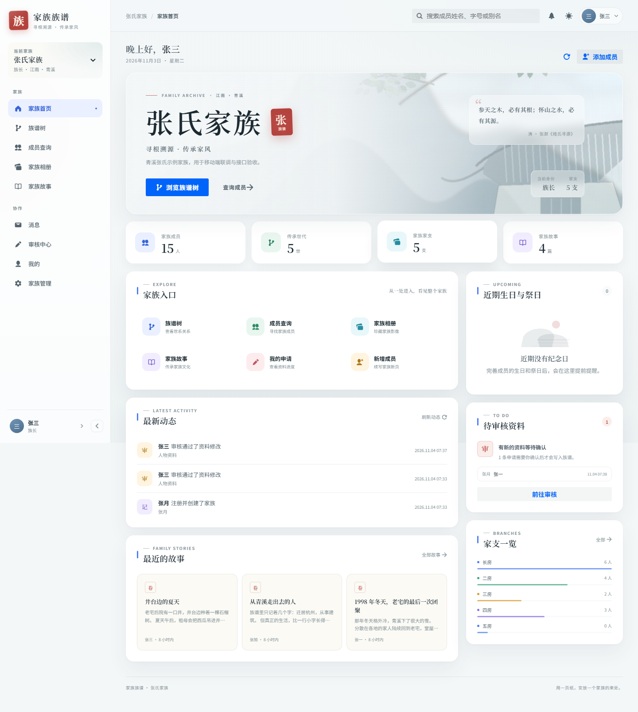
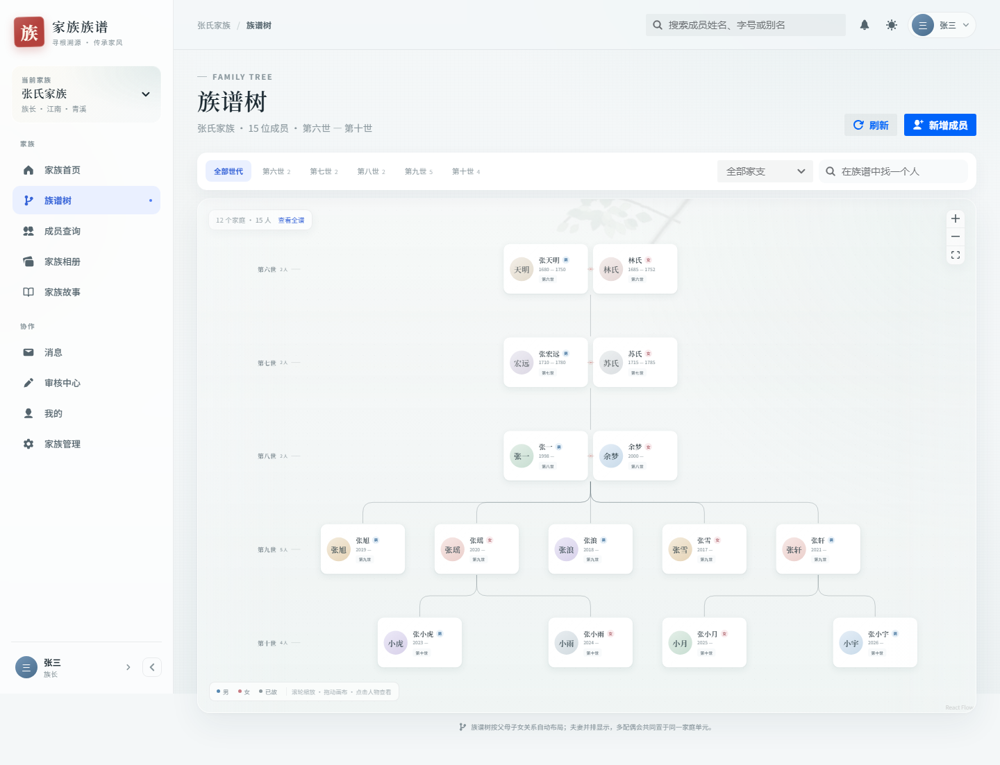
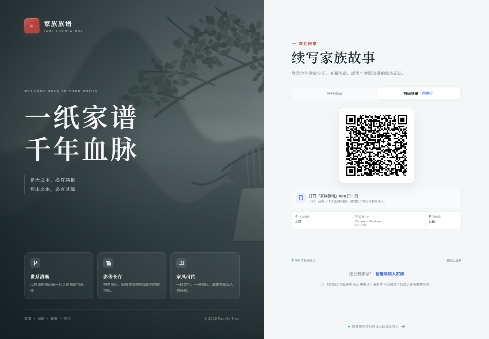

# 家族族谱 · 多家族信息管理系统

以族谱树为核心的多家族信息管理系统。Flutter、HarmonyOS 与 React Web 三端共用同一套
Go + MySQL 8.4 后端；Web 成员端已经完成族谱树、成员档案、相册、故事、消息、资料审核、
家族管理与手机 App 扫码登录等真实数据闭环（PostgreSQL 17 设计作为参考保留）。

后端数据契约见 [`packages/api-contracts/openapi.yaml`](packages/api-contracts/openapi.yaml)，
数据模型见 [`docs/backend/data-model.md`](docs/backend/data-model.md)。当前后端已落地
MySQL schema、迁移、登录/会话、Web 扫码登录、家族/族谱树/人物、资料申请与审核、
照片、故事、通知、邀请码、多家族切换与家族合并等接口。

> **产品不绑定任何姓氏。** APP 品牌名为「家族族谱」；首页的大标题、成员、家支和故事
> 都属于当前登录账户所在的家庭空间。代码里的家庭资料统一来自
> `FamilyProfile` / `DemoData.family`，接入登录后由账户所属家庭决定。
> 当前登录家庭为「凌氏家族」，产品品牌不绑定任何姓氏。

**GitHub：** https://github.com/43374166/family-genealogy
**Gitee：** https://gitee.com/fish-ling/family-genealogy

[](https://github.com/43374166/family-genealogy/actions/workflows/ios-unsigned.yml)

> 设计参考：`docs/reference/ui-home.png`、`docs/reference/ui-tree.png`
> 产品规划：`docs/reference/项目开发规划报告.docx`

## 运行预览

以下为实际运行截图（更多页面见 [docs/screenshots](docs/screenshots/README.md)）：

| Flutter 首页 | Flutter 族谱树 |
| --- | --- |
|  |  |

| Web 家族首页 | Web 族谱树 |
| --- | --- |
|  |  |

| Web 扫码登录（云端 IP 归属地） | Web 扫码登录（移动视口） |
| --- | --- |
|  |  |

2026-11-04 验收：云端 MySQL 已备份并恢复到本地（2 用户 / 26 人物 / 1 故事 / 2 照片，
迁移版本 22）；云端 API 部署扫码登录迁移与接口，Web 登录页完成扫码全流程，Flutter
Flutter 右上角统一扫码入口按二维码类型进入网页登录确认页或加入家族页；Web 族谱树改为
占满视口、滚轮缩放，人物卡片展示双历生卒、干支与生肖；`pnpm typecheck`、`pnpm lint`、
`pnpm test`（11 项）、`flutter analyze` 与 `flutter test` 全部通过。
2026-11-03 验收：Web 成员端 `pnpm typecheck`、`pnpm test`（6 项 Dagre 布局测试）、
`pnpm build` 全部通过，并完成 Chromium 真实登录/树交互/审核/故事/移动端走查。
2026-11-02 验收：`flutter analyze` 无问题；`flutter test` 15 项全部通过；
release APK 已构建（`familytree-0.47.4.apk`），Go 服务端全部测试通过。
历史验收：2026-10-30 Pixel 7 / Android 15 模拟器启动成功，并通过 HTTPS 实机网络验证。

## 当前进度

| 模块 | 目录 | 状态 |
| --- | --- | --- |
| Flutter iOS / Android | `apps/mobile` | ✅ Android 原型可运行，iOS 工程已生成（需 macOS 构建） |
| React Web 成员端 | `apps/web` | ✅ 账号密码/扫码登录、首页、族谱树、成员、档案、相册、故事、消息、审核、我的、家族管理 |
| 微信小程序 | `apps/mini-program` | 📁 占位，后续独立实现并复用 API |
| Go 服务端 | `server` | ✅ MySQL 8.4 + 登录/邀请码注册/绑定 + 族谱树/人物 API + 资料审核 + 人物/关系写入 + 多人物照片 + 故事配图 + 家族合并 + 每日备份/恢复 |
| Flutter 数据接入 | `apps/mobile` | ✅ 持久化登录、动态族谱、人物详情、资料审核、新增人物与关系、绑定人物、头像裁剪、相册多选/人物筛选、故事配图、家族合并接真实 API；其余页面仍为演示数据 |
| HarmonyOS 原生 | `apps/harmony` | ✅ ArkTS/ArkUI：登录/注册/手机验证码/找回密码、首页、族谱树、成员查询、人物档案、人物编辑/亲属关系、家族相册（多人关联/照片信息/压缩）、头像裁剪、家族故事（编辑/全屏图）、消息与资料审核（我的申请/逐字段详情/跳转）、家族合并、导入导出（二维码）、家庭切换/邀请/家族资料/家支/角色/账号安全；UI 逐页对齐 Flutter |
| API 契约 | `packages/api-contracts` | ✅ OpenAPI 3.1 初版 |

已实现的首期页面：

- **首页**：水墨家族头图、家族概览、六个快捷入口、最新动态；支持下拉刷新。
- **主题与圆角**：设置中可切换亮色、暗色、跟随系统；全站卡片、输入框、弹层等圆角统一收紧。
- **族谱树**：夫妻卡片并排，配偶并排显示；父亲、母亲都从各自卡片中心接入共同子女横线，
  每对夫妻的子女共用一条横线，不同配偶的横线分层错开；支持缩放 / 拖动、世代筛选、人物选中态和底部人物摘要。
- **人物档案**：生平、亲属关系、资料版本提示；个人照片区只展示仅关联本人的照片。
- **成员查询**：姓名 / 籍贯 / 职业搜索、按世代筛选。
- **资料申请与审核**：成员选择人物后提交修改，族长/管理员可查看待审核并同意或拒绝；
  通过后由服务端事务写入人物版本并记录审计。
- **头像**：相册选图后可在 App 内裁切；族长和管理员可在“设置—成员头像”为任意成员设置头像。
- **父母与配偶**：本姓成员编辑/新增时选择父母；非本姓（母亲方）成员改为选择配偶，配偶候选仅显示男性。
- **多配偶**：一位丈夫的多位配偶会并排显示在丈夫旁边；不同配偶的子女使用独立的连接线和错开的横向层级，不会重合成一条线。
- **删除人物**：族长/管理员可在人物档案右上角删除误录人物；删除后结束亲属关系、解除账号绑定和照片人物标记，族谱与相册同步刷新，审计保留。
- **家族相册**：支持一次多选上传，照片可关联多位人物，并可按一位或多位人物筛选。
- **家族故事**：写故事时可一次选择最多 9 张图片，客户端压缩后上传，详情页可查看大图。
- **生肖**：按公历/农历生日换算农历年份，自动显示对应生肖。
- **家族合并**：加入新家族后，原家族为空则自动归档；有数据则生成合并申请，目标家族族长选择人物、故事、照片，以及目标家支、起始世代和挂靠父辈。
- **消息**、**我的**：可交互的真实数据页面。
- 底部导航：首页、族谱树、添加、消息、我的。
- **HarmonyOS 原生端**：`apps/harmony` 使用 ArkTS/ArkUI 重写登录、首页、族谱树、成员查询、人物档案、新增人物、删除人物、家族相册、头像裁剪、家族故事、消息通知、资料/绑定审核、家族合并和导入导出，直连同一套 API；照片多人关联、故事编辑、推送等仍待补齐。

已实现的 Web 成员端（`apps/web`）：

- React 18 + TypeScript + Vite 7 + react-router-dom 7 + Redux Toolkit + Semi Design +
  axios，族谱树使用 React Flow 12 + Dagre 布局。
- 账号密码 / 扫码登录（`qrcode.react`）、注册、家族首页（概览、动态、纪念日、待办、
  家支、最近故事）、成员查询、人物档案、家族相册、家族故事与阅读页、消息中心、
  审核中心/我的申请、我的、家族管理。
- 族谱树占满顶栏以下视口，页面不纵向滚动；滚轮缩放、拖拽平移；人物卡片直接展示
  双历生卒日期、干支年与生肖，无需进入完整档案。
- 普通成员与族长/管理员使用同一套页面，按角色显示审核、家族管理、编辑或申请入口。
- 头像/相册均通过带 Bearer 的 Blob 请求加载；Desktop 侧栏与移动端抽屉/底栏自适应。

关系编辑、照片上传、家庭切换、登录会话续期和登录失败锁定均已接入主流程；
仍带「原型 / 演示」提示的入口不会假装已经完成持久化。
默认服务器地址为线上 `https://family.fishdream.xyz:10443`，Android 与 iOS 打包均连接云端；
该域名当前只监听 10443，`10433` 会超时。本地开发可用
`--dart-define=API_BASE_URL=http://10.0.2.2:8080` 覆盖。Web 开发服务器也默认代理到云端
10443，本地联调时通过 `VITE_PROXY_TARGET` 改回 `http://127.0.0.1:8080`。

## 快速启动（Windows + Android 模拟器）

本机已安装并验证：

- Flutter `3.35.5` / Dart `3.9.2`
- Android SDK Platform 35 / 36、Build Tools 35.0.0、Platform Tools、Emulator
- NDK `27.0.12077973`、CMake `3.22.1`（首次 Gradle 构建时自动安装）
- AVD：`family_pixel`（Pixel 7 / Android 15 / x86_64）
- JDK：`C:\Program Files\Java\jdk-22`
- Gradle `8.12`，wrapper 使用华为云镜像（GitHub Releases 在本机不可达）

首次运行或模拟器没有启动时：

```powershell
# 1. 启动模拟器（AVD 已迁移到 D 盘，避免占满 C 盘）
$env:ANDROID_AVD_HOME = "D:\AppData\Local\Android\avd"
& "$env:ANDROID_HOME\emulator\emulator.exe" -avd family_pixel -gpu host

# 2. 确认设备在线
& "$env:ANDROID_HOME\platform-tools\adb.exe" devices

# 3. 运行 Flutter（建议使用 JDK 22；GitHub 不可达时加 --no-version-check）
$env:JAVA_HOME = "C:\Program Files\Java\jdk-22"
$env:GRADLE_USER_HOME = "D:\AppData\Local\Gradle"
# 清华镜像未收录本版本 Flutter Engine AAR，使用 Flutter 中国镜像
$env:FLUTTER_STORAGE_BASE_URL = "https://storage.flutter-io.cn"
cd apps\mobile
flutter --no-version-check run -d emulator-5554
```

也可以直接执行：

```powershell
powershell -ExecutionPolicy Bypass -File .\scripts\run-android.ps1
```

同步到两个远端：

```powershell
git push origin master   # Gitee
git push github master   # GitHub
```

构建安装包：

```powershell
cd apps\mobile
$env:FLUTTER_STORAGE_BASE_URL = "https://storage.flutter-io.cn"
flutter --no-version-check build apk --debug
# 产物：build\app\outputs\flutter-apk\app-debug.apk
# 安装：adb install -r build\app\outputs\flutter-apk\app-debug.apk
```

### Flutter 检查

```powershell
cd apps\mobile
dart format --output=none --set-exit-if-changed lib test
flutter --no-version-check analyze
flutter --no-version-check test
```

> 说明一：新版 Android 命令行工具提示 `--licenses` 已不再需要，Flutter Doctor
> 可能仍显示 “Android license status unknown”。本项目所需 SDK 组件均已安装，
> 实际构建不受影响；不依赖 `flutter doctor --android-licenses`。
>
> 说明二：Flutter SDK 仍使用清华镜像，但该镜像目前没有本版本的 Engine AAR。
> `android/build.gradle.kts` 已为 `io.flutter` 增加 Flutter 中国镜像和官方仓库回退，
> 脚本也会把 `FLUTTER_STORAGE_BASE_URL` 指向 `https://storage.flutter-io.cn`。
> Gradle 发行包则通过 `gradle-wrapper.properties` 中的华为云镜像获取。

## Web 成员端（React + Vite）

```powershell
# 先启动 server（默认 :8080）
cd apps\web
pnpm install
pnpm dev
# http://127.0.0.1:5173
```

开发服务器把 `/api` 代理到 `http://127.0.0.1:8080`。生产构建与 Nginx SPA fallback
配置见 [apps/web/README.md](apps/web/README.md)。

```powershell
cd apps\web
pnpm typecheck
pnpm test       # Dagre 家庭单元布局测试
pnpm build
```

Web 截图见 [docs/screenshots/web](docs/screenshots/web/README.md)。

## HarmonyOS 原生端

`apps/harmony` 是独立的 ArkTS/ArkUI 工程，不是 Flutter 套壳。已接入登录、首页、
族谱树、成员查询、人物档案、新增人物和删除人物，默认连接线上 API。

用 DevEco Studio 打开 `apps/harmony`，或使用本机 DevEco 命令行构建：

```powershell
$env:JAVA_HOME='D:\install\DevEco Studio\jbr'
$env:DEVECO_SDK_HOME='D:\install\DevEco Studio\sdk'
$env:DEVECO_HOME='D:\install\DevEco Studio'
$env:PATH='D:\install\DevEco Studio\tools\node;D:\install\DevEco Studio\tools\ohpm\bin;D:\install\DevEco Studio\tools\hvigor\bin;' + $env:PATH
cd apps\harmony
hvigorw.bat --mode module -p module=entry@default -p product=default -p buildMode=release assembleHap --no-daemon
# 产物：entry\build\default\outputs\default\entry-default-unsigned.hap
```

仓库不提交开发者签名证书，产物是 unsigned HAP；用 DevEco 的 Signing Configs
生成签名后即可通过 `hdc install` 安装。完整说明见
[apps/harmony/README.md](apps/harmony/README.md)。

> 线上域名目前只解析到 IPv6。没有 IPv6 的设备登录时若提示“找不到请求主机名字”，
> 请在登录页切到“家庭局域网”（`http://192.168.1.36:10080/family-api`，仅内网可访问），
> 客户端也会在解析失败时自动回退一次。

## iOS 云端打包（无签名）

> Android 打包按本地签名流程处理，不再走 GitHub Actions；GitHub 只负责 iOS 构建。

Android 显示名为「家族族谱」；iOS 本机签名流程要求 ASCII 应用名，因此使用
`FamilyTree`，应用内部仍是中文。后续不同家庭登录只改变家庭空间数据，不改变
APP 品牌。

仓库已包含 [.github/workflows/ios-unsigned.yml](.github/workflows/ios-unsigned.yml)：

- 在 GitHub Actions 的 `macos-15` Runner 上使用 Flutter 3.35.5 编译 iOS
- 不执行 Apple 签名，产出：
  - `Runner-unsigned.ipa`
  - `Runner-unsigned.app.zip`
  - `SHA256SUMS.txt`
- 推送到 `master` 且改动 `apps/mobile/**` 时自动触发，也可在 Actions 页面手动运行
- **无签名 IPA 不能安装到普通 iPhone，也不能上传 TestFlight**；它只用于验证 iOS 编译链路和提前产出待签名包

首次 GitHub Actions 构建已通过（2026-10-30，macOS 15 / Xcode）：
[Actions 运行记录](https://github.com/43374166/family-genealogy/actions/runs/40920458742)

- Artifact：`family-tree-ios-unsigned-1`（约 31 MB）
- 含 `Runner-unsigned.ipa`、`Runner-unsigned.app.zip`、`SHA256SUMS.txt`
- Artifact 下载需要登录 GitHub；保留 14 天，过期可在 Actions 页面重新运行

## 目录结构

```text
family-genealogy/
├── apps/
│   ├── mobile/                 # Flutter（iOS + Android）
│   │   ├── lib/                # 页面、主题、模型、演示数据
│   │   ├── android/            # Android 工程
│   │   ├── ios/                # iOS 工程
│   │   ├── assets/             # 水墨背景、字体、应用图标
│   │   └── test/               # Widget 冒烟测试
│   ├── web/                    # React + Vite 成员端（Semi / Redux / React Flow + Dagre）
│   ├── harmony/                # ArkTS / ArkUI 鸿蒙原生端
│   └── mini-program/           # 微信小程序，预留
├── server/                     # Go REST API + MySQL 8.4
├── packages/
│   └── api-contracts/          # OpenAPI / 错误码
├── data/                       # 本地 JSON 与媒体数据的未来位置
├── deploy/                     # Nginx / Docker Compose，预留
├── docs/
│   ├── reference/              # 规划报告与 UI 参考图
│   ├── screenshots/            # Flutter / Web 运行截图
│   └── development.md          # 技术决策与后续路线
├── scripts/
│   └── run-android.ps1
└── README.md
```

## 设计原则

1. 账户（User）与人物（Person）分离，不以姓名作为唯一标识。
2. 普通成员不直接覆盖正式档案；修改先生成申请，审核通过后才写入。
3. 权限、数据校验、审计必须由服务端执行，客户端按钮隐藏不等于权限控制。
4. Web 端页面只消费真实 API；空状态、上传失败和权限不足都明确呈现，不冒充成功。
5. 族谱树优先纵向世系：移动端聚焦缩放、拖动与人物摘要，Web 端使用 React Flow +
   Dagre 自动布局家庭单元。

## 下一步

1. 在 Android / iOS / HarmonyOS 真机上继续打磨首页、族谱树与离线体验。
2. 补齐 Web 相册/头像上传的私有 OBS 环境联调，并补独立的 `/admin` 后台管理端。
3. 把服务端实际响应同步回 OpenAPI（当前契约仅覆盖早期只读接口），补页面级 E2E。
4. 继续统一 Web / Flutter / HarmonyOS 的时间、权限和空状态表达。
5. 单独评估鸿蒙与小程序，不阻塞首期交付。

详细说明见 [docs/development.md](docs/development.md)。
