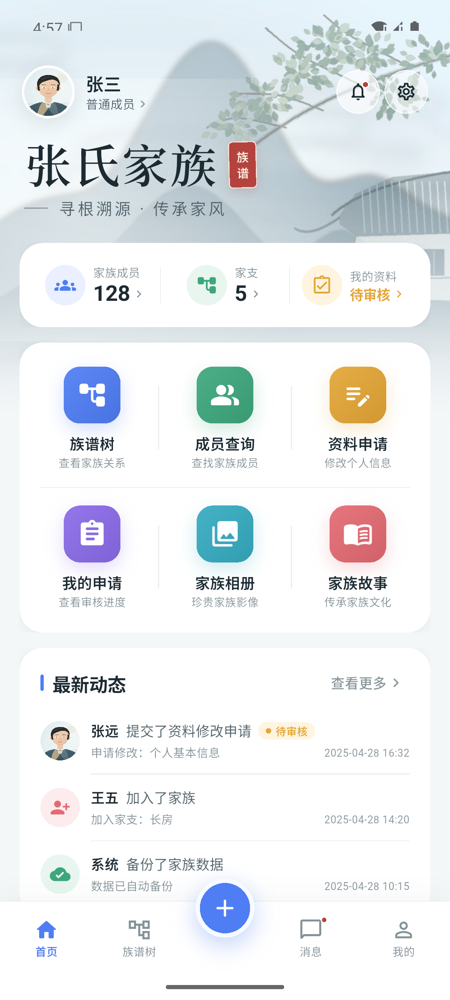
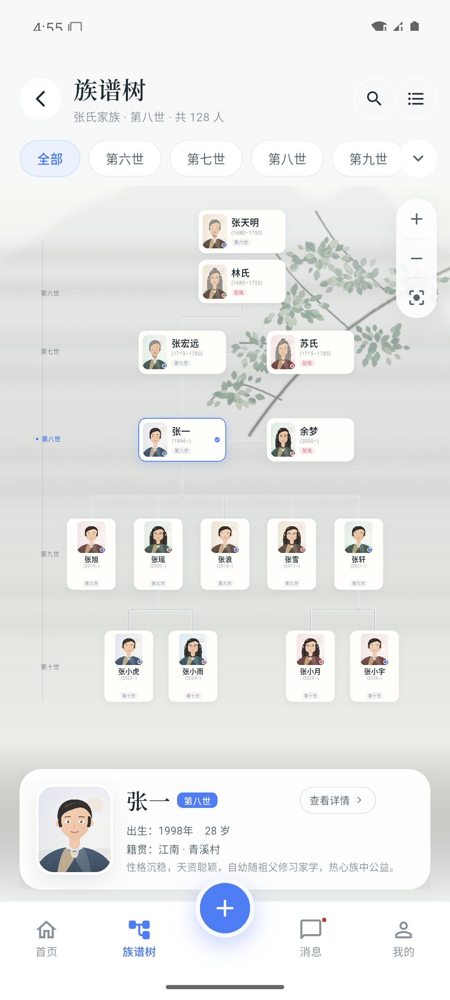

# 家族族谱 · 多家族信息管理系统

以族谱树为核心的多家族信息管理系统。Flutter 端已接入登录、首页和族谱树真实 API；
Go + MySQL 8.4 后端提供家庭与人物只读接口（PostgreSQL 17 设计作为参考保留），
Web、鸿蒙和小程序暂留扩展位置。

后端数据契约见 [`packages/api-contracts/openapi.yaml`](packages/api-contracts/openapi.yaml)，
数据模型见 [`docs/backend/data-model.md`](docs/backend/data-model.md)。当前后端已落地
MySQL schema、迁移、登录/会话、家庭/族谱树/人物只读 API；Flutter 的登录、首页、
动态族谱树、人物详情和成员搜索已接真实 API。资料申请、审核和写入还未完成。

> **产品不绑定任何姓氏。** APP 品牌名为「家族族谱」；首页的大标题、成员、家支和故事
> 都属于当前登录账户所在的家庭空间。代码里的家庭资料统一来自
> `FamilyProfile` / `DemoData.family`，接入登录后由账户所属家庭决定。
> 当前登录家庭为「凌氏家族」，产品品牌不绑定任何姓氏。

**GitHub：** https://github.com/43374166/family-genealogy
**Gitee：** https://gitee.com/fish-ling/family-genealogy

[](https://github.com/43374166/family-genealogy/actions/workflows/ios-unsigned.yml)

> 设计参考：`docs/reference/ui-home.png`、`docs/reference/ui-tree.png`
> 产品规划：`docs/reference/项目开发规划报告.docx`

## 运行预览

以下为 Android 模拟器中的实际运行截图（更多页面见 [docs/screenshots](docs/screenshots/README.md)）：

| 首页 | 族谱树 |
| --- | --- |
|  |  |

2026-10-30 验收：Pixel 7 / Android 15 模拟器启动成功；`flutter analyze` 无问题；
`flutter test` 7 项全部通过；release APK 已构建并通过 HTTPS 实机网络验证。

## 当前进度

| 模块 | 目录 | 状态 |
| --- | --- | --- |
| Flutter iOS / Android | `apps/mobile` | ✅ Android 原型可运行，iOS 工程已生成（需 macOS 构建） |
| React Web | `apps/web` | 📁 占位，后续开发 |
| 鸿蒙端 | `apps/harmony` | 📁 占位，需单独验证 Flutter/ArkUI 路线 |
| 微信小程序 | `apps/mini-program` | 📁 占位，后续独立实现并复用 API |
| Go 服务端 | `server` | ✅ MySQL 8.4 + 登录/邀请码注册/绑定 + 族谱树/人物 API + 资料审核 + 人物/关系写入 |
| Flutter 数据接入 | `apps/mobile` | ✅ 登录注册、动态族谱、人物详情、资料审核、新增人物与关系、绑定人物接真实 API；其余页面仍为演示数据 |
| API 契约 | `packages/api-contracts` | ✅ OpenAPI 3.1 初版 |

已实现的首期移动端页面：

- **首页**：水墨家族头图、家族概览、六个快捷入口、最新动态。
- **族谱树**：夫妻卡片并排，子代从夫妻中线的连接点向下生长；支持缩放 / 拖动、
  世代筛选、人物选中态和底部人物摘要。
- **人物档案**：生平、亲属关系、资料版本提示。
- **成员查询**：姓名 / 籍贯 / 职业搜索、按世代筛选。
- **资料申请与审核**：成员选择人物后提交修改，族长/管理员可查看待审核并同意或拒绝；
  通过后由服务端事务写入人物版本并记录审计。
- **消息**、**我的**、**家族相册**、**家族故事**：可交互的原型页面。
- 底部导航：首页、族谱树、添加、消息、我的。

关系编辑、照片上传、家庭切换、刷新令牌和登录限流**尚未接入**。
界面上带「原型 / 演示」提示的入口，不会假装已经完成持久化。

## 快速启动（Windows + Android 模拟器）

本机已安装并验证：

- Flutter `3.35.5` / Dart `3.9.2`
- Android SDK Platform 35 / 36、Build Tools 35.0.0、Platform Tools、Emulator
- NDK `27.0.12077973`、CMake `3.22.1`（首次 Gradle 构建时自动安装）
- AVD：`family_pixel`（Pixel 7 / Android 15 / x86_64）
- JDK：`C:\Program Files\Java\jdk-22`
- Gradle `8.12`，wrapper 使用华为云镜像（GitHub Releases 在本机不可达）

首次运行或模拟器没有启动时：

```powershell
# 1. 启动模拟器（AVD 已迁移到 D 盘，避免占满 C 盘）
$env:ANDROID_AVD_HOME = "D:\AppData\Local\Android\avd"
& "$env:ANDROID_HOME\emulator\emulator.exe" -avd family_pixel -gpu host

# 2. 确认设备在线
& "$env:ANDROID_HOME\platform-tools\adb.exe" devices

# 3. 运行 Flutter（建议使用 JDK 22；GitHub 不可达时加 --no-version-check）
$env:JAVA_HOME = "C:\Program Files\Java\jdk-22"
$env:GRADLE_USER_HOME = "D:\AppData\Local\Gradle"
# 清华镜像未收录本版本 Flutter Engine AAR，使用 Flutter 中国镜像
$env:FLUTTER_STORAGE_BASE_URL = "https://storage.flutter-io.cn"
cd apps\mobile
flutter --no-version-check run -d emulator-5554
```

也可以直接执行：

```powershell
powershell -ExecutionPolicy Bypass -File .\scripts\run-android.ps1
```

同步到两个远端：

```powershell
git push origin master   # Gitee
git push github master   # GitHub
```

构建安装包：

```powershell
cd apps\mobile
$env:FLUTTER_STORAGE_BASE_URL = "https://storage.flutter-io.cn"
flutter --no-version-check build apk --debug
# 产物：build\app\outputs\flutter-apk\app-debug.apk
# 安装：adb install -r build\app\outputs\flutter-apk\app-debug.apk
```

### Flutter 检查

```powershell
cd apps\mobile
dart format --output=none --set-exit-if-changed lib test
flutter --no-version-check analyze
flutter --no-version-check test
```

> 说明一：新版 Android 命令行工具提示 `--licenses` 已不再需要，Flutter Doctor
> 可能仍显示 “Android license status unknown”。本项目所需 SDK 组件均已安装，
> 实际构建不受影响；不依赖 `flutter doctor --android-licenses`。
>
> 说明二：Flutter SDK 仍使用清华镜像，但该镜像目前没有本版本的 Engine AAR。
> `android/build.gradle.kts` 已为 `io.flutter` 增加 Flutter 中国镜像和官方仓库回退，
> 脚本也会把 `FLUTTER_STORAGE_BASE_URL` 指向 `https://storage.flutter-io.cn`。
> Gradle 发行包则通过 `gradle-wrapper.properties` 中的华为云镜像获取。

## iOS 云端打包（无签名）

Android 显示名为「家族族谱」；iOS 本机签名流程要求 ASCII 应用名，因此使用
`FamilyTree`，应用内部仍是中文。后续不同家庭登录只改变家庭空间数据，不改变
APP 品牌。

仓库已包含 [.github/workflows/ios-unsigned.yml](.github/workflows/ios-unsigned.yml)：

- 在 GitHub Actions 的 `macos-15` Runner 上使用 Flutter 3.35.5 编译 iOS
- 不执行 Apple 签名，产出：
  - `Runner-unsigned.ipa`
  - `Runner-unsigned.app.zip`
  - `SHA256SUMS.txt`
- 推送到 `master` 且改动 `apps/mobile/**` 时自动触发，也可在 Actions 页面手动运行
- **无签名 IPA 不能安装到普通 iPhone，也不能上传 TestFlight**；它只用于验证 iOS 编译链路和提前产出待签名包

首次 GitHub Actions 构建已通过（2026-10-30，macOS 15 / Xcode）：
[Actions 运行记录](https://github.com/43374166/family-genealogy/actions/runs/40920458742)

- Artifact：`family-tree-ios-unsigned-1`（约 31 MB）
- 含 `Runner-unsigned.ipa`、`Runner-unsigned.app.zip`、`SHA256SUMS.txt`
- Artifact 下载需要登录 GitHub；保留 14 天，过期可在 Actions 页面重新运行

## 目录结构

```text
family-genealogy/
├── apps/
│   ├── mobile/                 # Flutter（iOS + Android）
│   │   ├── lib/                # 页面、主题、模型、演示数据
│   │   ├── android/            # Android 工程
│   │   ├── ios/                # iOS 工程
│   │   ├── assets/             # 水墨背景、字体、应用图标
│   │   └── test/               # Widget 冒烟测试
│   ├── web/                    # React 成员端 + 后台，预留
│   ├── harmony/                # 鸿蒙技术验证，预留
│   └── mini-program/           # 微信小程序，预留
├── server/                     # Go REST API，当前不实现
├── packages/
│   └── api-contracts/          # OpenAPI / 错误码，预留
├── data/                       # 本地 JSON 与媒体数据的未来位置
├── deploy/                     # Nginx / Docker Compose，预留
├── docs/
│   ├── reference/              # 规划报告与 UI 参考图
│   ├── screenshots/            # Android 模拟器运行截图
│   └── development.md          # 技术决策与后续路线
├── scripts/
│   └── run-android.ps1
└── README.md
```

## 设计原则

1. 账户（User）与人物（Person）分离，不以姓名作为唯一标识。
2. 普通成员不直接覆盖正式档案；修改先生成申请，审核通过后才写入。
3. 权限、数据校验、审计必须由服务端执行，客户端按钮隐藏不等于权限控制。
4. 示例数据只存于 `lib/data/demo_data.dart`，不冒充真实后端数据。
5. 族谱树优先纵向世系，移动端重点优化缩放、拖动与人物摘要。

## 下一步

1. 在 Android 真机 / 模拟器上继续打磨首页与族谱树交互。
2. 冻结 Person / Relationship / EditRequest 数据结构，输出 OpenAPI 草案。
3. 实现 Go API + JSON Repository（含原子写、备份、审计），再接 Flutter。
4. 复用同一套 API 开发 React 成员端与独立后台管理端。
5. 单独评估鸿蒙与小程序，不阻塞首期交付。

详细说明见 [docs/development.md](docs/development.md)。
