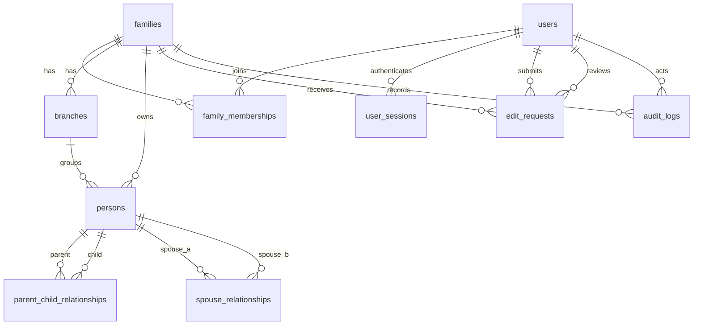

# 后端数据模型 v1（冻结草案）

状态：**v1 冻结草案**。运行库为 **MySQL 8.4 LTS**（InnoDB / utf8mb4）；PostgreSQL 17
的完整 DDL 保留在 `server/internal/database/migrations/postgres/` 作为设计参考，并继续由 CI 验证。
本阶段先稳定字段、约束、权限边界和迁移方式；业务 API 随后按
`packages/api-contracts/openapi.yaml` 实现。

## 1. 设计目标

- 多家族、多用户：一个账户可以加入多个家族，每个家族有独立的成员、人物和家支。
- 家族隔离由数据库约束兜底，而不是只靠服务端 `WHERE family_id = ...`。
- 人物、父母子女、婚姻关系可追溯；禁止跨家族关系、自我关系和父母子女环路。
- 生卒日期允许“只知道年份 / 只知道月日 / 农历 / 不详”，不强行伪造完整公历日期。
- 写操作走申请与审核，保留前后快照和审计日志；并发修改用版本号防覆盖。
- 所有时间以 UTC 存储（MySQL `DATETIME(6)`）；ID 使用应用生成的 UUID 字符串；
  客户端展示时再转本地时区。
- 不用数据库枚举类型，改用 `VARCHAR + CHECK`，便于后续迁移和兼容旧数据。
- MySQL 与 PostgreSQL 的字段语义保持一致；差异集中在索引、JSON、全文检索和触发器能力。

## 2. 关系图

## 3. 实体与关键字段

### 3.1 `users`（账户，全局）

| 字段 | 说明 |
| --- | --- |
| `id` | UUID |
| `login_name` | 登录名，唯一；MySQL 使用 `utf8mb4_0900_ai_ci` 实现不区分大小写 |
| `email` / `phone` | 可选，唯一；手机号按 E.164 存储 |
| `password_hash` | 必须是 Argon2id，数据库约束 `$argon2id$` 前缀 |
| `display_name` | 展示名 |
| `status` | `active / disabled / pending` |
| `failed_login_attempts` / `locked_until` | 登录限流与锁定 |
| `last_login_at` | 最近登录时间 |

账户不直接带 `family_id`。家庭身份由 `family_memberships` 表达，因此同一账户可以加入
多个家族，也方便以后做家庭切换。

### 3.2 `families`（家族空间）

| 字段 | 说明 |
| --- | --- |
| `name` / `surname` | 家族名、姓氏；姓氏可为多字 |
| `motto` / `region` / `description` | 家风、地域、简介 |
| `status` | `active / archived` |
| `version` | 家族资料乐观锁版本 |

### 3.3 `family_memberships`（账户在家族中的身份）

| 字段 | 说明 |
| --- | --- |
| `role` | `owner / admin / member` |
| `status` | `active / invited / revoked` |
| `person_id` | 可关联到本家族某个人物；同一人物同时只能有一个未撤销账户 |
| `joined_at` | 加入时间 |

约束：

- `UNIQUE (family_id, user_id)`：一个账户在一个家族只有一条成员关系。
- 活跃 `owner` 每家族最多一个（MySQL 用生成列 + 唯一索引；PG 参考设计用部分唯一索引）。
- `person_id` 必须属于同一个 `family_id`（复合外键）。

### 3.4 `branches`（家支）

`id, family_id, name, description, sort_order`；`name` 在家族内唯一。人物可不属于任何家支。

### 3.5 `persons`（人物）

核心字段：

| 字段 | 说明 |
| --- | --- |
| `family_id` / `branch_id` | 所属家族、家支；复合外键保证家支同家族 |
| `surname` / `given_name` | 姓、名；`full_name` 为数据库生成列 |
| `courtesy_name` / `alias` | 字、别名 |
| `gender` | `male / female / other / unknown` |
| `generation_no` | 世代序号，1–99；展示文本在客户端生成 |
| `birth_order` | 同辈排序，可空 |
| `birth_*` / `death_*` | 年、月、日分开存；`calendar` 为 `gregorian / lunar / unknown`；`is_leap_month` 支持农历闰月；另存 `*_date_text` 原文 |
| `life_status` | `living / deceased / unknown` |
| `birth_place` / `residence` / `occupation` / `education` | 档案字段 |
| `biography` | 生平 |
| `status` | `active / merged / archived` |
| `version` | 乐观锁版本；每次正式更新 +1 |

日期规则：

- 只知道年份时，只填 `*_year`；不知道月日就保持 `NULL`，**不能**用 1 月 1 日冒充。
- `month` 存在时必须先有 `year`，`day` 存在时必须先有 `month`。
- 农历闰月用 `*_is_leap_month` 标记，不转换为公历。
- 生卒不详时字段全部为空，`life_status = 'unknown'`。

### 3.6 `parent_child_relationships`（父母子女）

| 字段 | 说明 |
| --- | --- |
| `parent_id` / `child_id` | 两端人物，必须同家族 |
| `parent_role` | `father / mother / parent / adoptive / step / guardian` |
| `status` | `active / ended` |

约束：

- 不能自己当自己的父母。
- `(family_id, parent_id, child_id)` 唯一。
- 同一子女最多一个活跃 `father`、一个活跃 `mother`；其他角色可多条。
- 触发器阻止形成父母子女环路；MySQL 版本使用递归 CTE。并发写关系时，业务层仍需在
  同一家族范围内串行化，避免两个事务分别通过检查后共同形成环路。PG 17 参考实现使用
  advisory lock，MySQL 版本在应用事务层补这一约束。
- 性别与角色的一致性（如 father 为 male）由业务层校验，避免历史/特殊情况被数据库误伤。

### 3.7 `spouse_relationships`（婚姻）

| 字段 | 说明 |
| --- | --- |
| `person_a_id` / `person_b_id` | 两端人物，强制按 UUID 升序存储 |
| `status` | `married / divorced / widowed / unknown` |
| `start_year` / `end_year` | 可只填年份 |
| `notes` | 备注 |

规范化顺序（`person_a_id < person_b_id`）防止 `(A,B)` 和 `(B,A)` 重复。

### 3.8 `edit_requests`（资料申请）

| 字段 | 说明 |
| --- | --- |
| `request_type` | `create_person / update_person / archive_person / add_parent_child / end_parent_child / add_spouse / end_spouse` |
| `payload` | JSON，按申请类型校验 |
| `base_version` | 修改人物时的客户端版本，用于冲突检测 |
| `status` | `pending / approved / rejected / cancelled` |
| `reviewer_user_id` / `review_note` / `reviewed_at` | 审核结果 |

只有 `owner/admin` 可以审核；申请人不能绕过家族范围。审核通过和正式写入必须在同一事务内完成，
并写审计日志。

### 3.9 `audit_logs`（审计日志，追加写）

记录 `family_id`、操作者、动作、对象、前后 JSON 快照、编辑申请、IP、UA、链路 ID。
数据库触发器禁止 `UPDATE/DELETE`，只允许追加和查询。

### 3.10 `user_sessions`（会话）

只保存刷新/会话令牌的 **SHA-256 哈希**，不保存明文令牌；记录过期、撤销、最近使用时间、
IP、UA。令牌轮换和撤销由认证模块负责。

## 4. MySQL 实现差异

- 主键/外键统一 `CHAR(36)` ASCII，应用生成 UUID；不使用 MySQL 的 `UUID()` 作为业务主键来源。
- `TEXT` 字段用 CHECK 限制字符长度；默认值为表达式 `('')`。
- 部分唯一索引改为生成列 + 唯一索引：活跃 owner、活跃人物账户、活跃 father / mother。
- JSONB 改为 JSON；pg_trgm 改为 FULLTEXT（ngram 分词）索引；INET 改为 `VARCHAR(45)`。
- MySQL 多语句迁移不是整体事务性的，迁移脚本保持小而可重入；生产发布前必须有备份和回滚预案。
- 完整公历日期（例如 2 月 30 日）的业务校验在服务层完成；数据库负责年月日分量和精度约束。

## 5. 权限矩阵（v1）

| 能力 | owner | admin | member |
| --- | --- | --- | --- |
| 查看家族、树、人物 | ✅ | ✅ | ✅ |
| 提交资料申请 | ✅ | ✅ | ✅ |
| 审核申请 | ✅ | ✅ | ❌ |
| 新建/归档人物、维护关系 | ✅ | ✅ | 通过申请 |
| 管理成员、家支 | ✅ | ✅ | ❌ |
| 导出家族数据 | ✅ | ✅ | ❌ |
| 转让 owner | ✅（唯一） | ❌ | ❌ |
| 删除家族 | ✅（二次确认） | ❌ | ❌ |

服务端必须重新校验角色和 `family_id`，前端隐藏按钮不构成授权。

## 6. 可靠性与运维底线

- 生产使用 MySQL 8.4 LTS（InnoDB / utf8mb4），连接强制 TLS。
- 应用账号与迁移账号分离：迁移用受控账号，运行时账号只授予所需 DML 权限。
- 触发器创建在 binary logging 开启时需要 `SUPER` 或 `log_bin_trust_function_creators=1`；
  生产更推荐用受控迁移账号，不在 API 进程启动时自动迁移。
- 迁移文件只前进、不修改历史；每个迁移在 CI 的干净 MySQL 8.4 上跑通。
- 备份：每日全量 + binlog 归档，保留至少 14 天；每季度做一次恢复演练。
- PostgreSQL 17 参考设计继续在 CI 的干净实例上应用，避免参考模型腐化。
- 关键表禁止级联删除；人物使用 `archived` 而非物理删除。
- 写接口使用幂等键、版本号和事务；审核通过后写审计日志。
- 所有对外错误使用 RFC 9457 `application/problem+json`；时间 RFC 3339；JSON 字段 camelCase。
- API 契约以 OpenAPI 3.1 为准，客户端不自行猜测关系方向或状态枚举。

## 7. 下一步

1. 认证：Argon2id 登录、会话令牌轮换、失败锁定。
2. 只读 API：`/me`、当前家族、族谱树、人物详情、成员查询。
3. 读 API 稳定后，再做编辑申请、审核事务、照片上传和审计查询。
